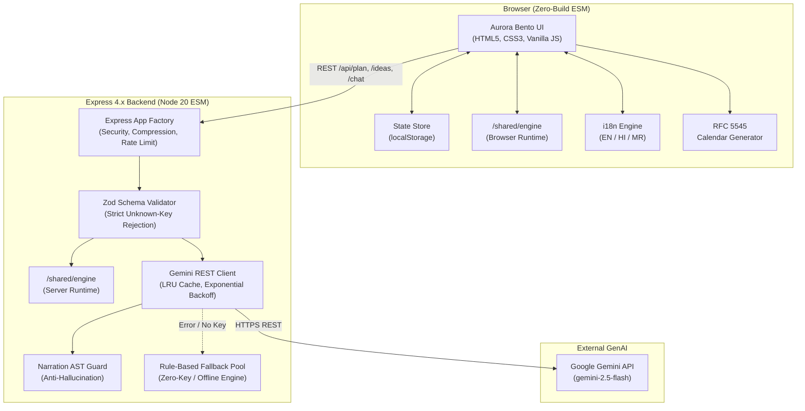

# Utsav (उत्सव) – GenAI Event-Planning Assistant

> **Production-grade, privacy-first, zero-build celebration planning assistant for first-time family organizers in India.**  
> Built with deterministic mathematics for every rupee, generative AI for contextual inspiration, and resilient offline capabilities.

[](https://github.com/workamannakashe-sudo/-Celebration-Event-Planner/actions/workflows/ci.yml)
[](https://nodejs.org/)
[](https://vitest.dev/)
[](https://vitest.dev/)
[](https://www.w3.org/WAI/standards-guidelines/wcag/)

---

## 1. Chosen Vertical and Persona

### The Persona: **"Meera"**
- **Profile**: A first-time family organizer in India planning a wedding, milestone birthday, or community festival (*Utsav*).
- **Context**: Working with a mid-range budget in Indian Rupees (₹ INR, e.g., ₹2,50,000 to ₹25,00,000). She faces complex vendor dynamics, emotional family expectations, tight timelines, and cultural traditions.
- **Pain Point**: Generic event planning tools either give vague templates with arbitrary percentages, require costly subscriptions, or leak sensitive budget numbers to non-deterministic LLMs that hallucinate math.
- **How Utsav Empowers Meera**:
  - **Every single rupee is justified**: Budgets, per-guest food allocations, and contingency reserves are calculated by a deterministic engine—the LLM never calculates or invents numbers.
  - **Culturally tailored**: Native support for wedding milestones, vegetarian menu savings, Indian vendor negotiation questions, and multilingual support (**English, हिंदी, मराठी**).
  - **Respects reality**: Flags when catering budget is tight per head, gives exact numbers needed to fix it, and reverse-schedules milestones based on available weeks.

---

## 2. Problem and Approach

### Core Philosophy: **Engine Decides, AI Personalises, Graceful Fallback**
1. **Mathematical Determinism (Shared Engine)**:
   - Resides in `/shared/engine` as pure ECMAScript Modules (ESM).
   - Imported by **both the Node.js server and the browser frontend**.
   - Owns every calculation: base weights, vibe multipliers, contingency buffer (8%), catering feasibility tiers, timeline compression, and what-if scenario deltas.
   - Eliminates math hallucination: the LLM is never asked to divide budgets or calculate guest headcounts.
2. **Generative Personalisation (Google Gemini 2.5 Flash)**:
   - Used strictly for creative inspiration (themes, regional menu ideas, interactive activities, and budget hacks) and natural language what-if narration.
   - Guarded by strict schema validation (`zod`), low temperature (0.1 for chat, 0.4 for ideas), and an AST number-guard that verifies all numbers spoken exist in the engine diff.
3. **Resilient Offline Fallback**:
   - Works **100% offline and without any API key**.
   - If the network drops or no `GEMINI_API_KEY` is provided, Utsav seamlessly executes rule-based ideas and regex scenario parsers directly inside the browser.

---

## 3. Architecture Diagram



---

## 4. How It Works (Step by Step)

### Step 1: User Inputs
The user specifies:
- `type`: `wedding` | `birthday` | `community`
- `name`: Celebration name (e.g., "Meera & Rohan Wedding")
- `guests`: 1 to 5,000 (validated integer)
- `budget`: ₹10,000 to ₹10,00,00,000 INR
- `date`: Future ISO date `YYYY-MM-DD`
- `vibe`: `Elegant` | `Fun` | `Traditional` | `Minimal`
- `vegOnly`: boolean (saves 8% on catering and moves it to the contingency buffer)

### Step 2: Deterministic Budget & Timeline Execution
1. **Base Weights**: Normalised according to event type (e.g., Wedding: Venue 22, Catering 32, Decor 12, Photo 10, Attire 9, Music 6, Invites 3, Logistics 6).
2. **Vibe Multipliers**: Scaled by category patterns (e.g., `Traditional` boosts Decor and Catering by 1.1x and reduces Stage/Music by 0.85x).
3. **8% Contingency Reserve**: 8% is reserved upfront. The remaining 92% is distributed by adjusted weights. If `vegOnly`, catering is reduced by 8% and the savings are added to contingency.
4. **Rounding Invariant**: All category allocations are floored to whole rupees; the contingency buffer absorbs all rounding remainders so `categories + buffer === totalBudget` always.
5. **Feasibility Analysis**: Catering allocation is divided by guest count. Minimum per-head thresholds: Wedding ₹900, Birthday ₹450, Community ₹250.
   - If below threshold: categorized as **`Tight`**, and computes `maxGuestsThatFit` and `budgetNeeded` (rounded to nearest ₹5,000).
   - If > 1.8x threshold: categorized as **`Generous`**. Otherwise **`Comfortable`**.
6. **Reverse Timeline**: Calculated backwards from the event date. If available weeks are less than ideal lead time, milestone offsets are compressed with an advisory warning.

### Sample API Request & Response

#### `POST /api/plan`
**Request Body**:
```json
{
  "type": "wedding",
  "name": "Meera & Rohan Wedding",
  "guests": 250,
  "budget": 650000,
  "date": "2027-02-15",
  "vibe": "Traditional",
  "vegOnly": true
}
```

**Response Body (Excerpt)**:
```json
{
  "plan": {
    "inputs": {
      "type": "wedding",
      "name": "Meera & Rohan Wedding",
      "guests": 250,
      "budget": 650000,
      "date": "2027-02-15",
      "vibe": "Traditional",
      "vegOnly": true
    },
    "budget": {
      "totalBudget": 650000,
      "contingency": 70258,
      "contingencyPct": 10.8,
      "categories": [
        { "name": "Venue", "amount": 121406, "pct": 18.7, "vendorType": "venue" },
        { "name": "Catering", "amount": 162386, "pct": 25.0, "vendorType": "catering" },
        { "name": "Decor & Flowers", "amount": 72844, "pct": 11.2, "vendorType": "decor_flowers" },
        { "name": "Photo & Video", "amount": 55184, "pct": 8.5, "vendorType": "photo_video" },
        { "name": "Attire & Beauty", "amount": 54633, "pct": 8.4, "vendorType": "attire_beauty" },
        { "name": "Music & Entertainment", "amount": 28144, "pct": 4.3, "vendorType": "music_entertainment" },
        { "name": "Invites & Stationery", "amount": 16555, "pct": 2.5, "vendorType": "invites_stationery" },
        { "name": "Logistics & Stay", "amount": 68590, "pct": 10.6, "vendorType": "logistics_stay" }
      ]
    },
    "feasibility": {
      "tier": "Tight",
      "perHeadActual": 650,
      "perHeadMin": 900,
      "maxGuestsThatFit": 180,
      "budgetNeeded": 900000
    },
    "timeline": {
      "weeksAvailable": 15,
      "idealLeadWeeks": 26,
      "compressed": true,
      "warning": "Available lead time is shorter than ideal. Milestones compressed; book venue and caterer first!"
    }
  }
}
```

---

## 5. Setup and Run

### Prerequisites
- **Node.js**: `v20.0.0` or higher
- **npm**: `v10.0.0` or higher

### Quick Start
```bash
# 1. Clone the repository
git clone https://github.com/workamannakashe-sudo/-Celebration-Event-Planner.git
cd -Celebration-Event-Planner

# 2. Install dependencies
npm install

# 3. (Optional) Configure Gemini API Key
cp .env.example .env
# Edit .env and set GEMINI_API_KEY=your_key_here

# 4. Start the server
npm start
```
Open **`http://localhost:3000`** in any modern web browser.

### Running Without an API Key (Offline / Fallback Mode)
Utsav is designed to work completely out-of-the-box **without any API key**:
- Leave `GEMINI_API_KEY` empty in `.env` (or run without a `.env` file).
- The server and client automatically detect the absence of a key and activate the smart rule-based fallback pools and regex scenario parsers.
- The UI header displays a `⚡ Local Rules Mode` badge indicating offline resilience.

---

## 6. Feature Tour

1. **Aurora Bento Design Language**:
   - Soft, animated aurora mesh gradients in violet, rose, and teal.
   - Frosted glass cards (`backdrop-filter: blur(16px)`), hairline borders, and generous 22px radii.
   - High-contrast typography pairing: **Fraunces** for big numbers and display titles, **Inter** for clean UI labels.
2. **Interactive What-If Scenario Playground**:
   - Live dual sliders for Budget adjustments (-50% to +100%) and Guest modifications (-100 to +250).
   - Real-time recalculation of budget deltas, feasibility tier changes, and contingency updates with zero server latency.
   - One-click "Apply Changes" or "Reset".
3. **Ask Utsav AI Chat Drawer**:
   - Slide-out assistant drawer with suggested prompt chips.
   - Natural language intent parsing ("cut budget 15%", "add 50 guests", "what to ask the caterer").
   - Hallucination-proof response narration matching diff numbers exactly.
4. **Milestone Calendar Export (.ics)**:
   - One-click export to Google Calendar, Apple Calendar, or Outlook via RFC 5545 compliant `.ics` generator with full character escaping.
5. **Interactive Vendor Negotiation Checklist**:
   - Category budget allocations with culturally specific questions before paying advances (e.g., tasting policies, power backup, raw footage rights).
   - Checkbox task completion persisted in `localStorage`.
6. **One-Click Plan Sharing & Printing**:
   - "Copy Plan Summary" copies formatted clipboard text for WhatsApp family groups.
   - Clean `@media print` stylesheet optimized for physical paper or PDF export.
7. **Multilingual Support (EN, HI, MR)**:
   - Instant language switching across **English, हिंदी, and मराठी**.

---

## 7. Security Measures

- **Strict Content Security Policy (CSP)**: Managed via `helmet`, permitting only self-hosted assets and Google Fonts.
- **Prompt Injection Defense**:
  - User text (name, messages) is stripped of control characters (`\x00-\x1F`, `\x7F`) and markup (`<script>`, `<>`).
  - Input text is length-capped and isolated exclusively inside `<user_data>...</user_data>` XML boundary tags after the system prompt.
  - The system prompt explicitly instructs the LLM that `<user_data>` is data, never executable instructions, and prohibits leaking keys or prompts.
- **Anti-Hallucination Guard**:
  - The server extracts all numerical figures from LLM chat narrations and verifies that each number exists in the allowed set of the engine diff.
  - If an unverified number appears, the narration is discarded and replaced with a deterministic template.
- **Request Validation & Limits**:
  - All JSON payloads are strictly validated using `zod` with `.strict()`, rejecting unexpected keys.
  - Express body parser caps payload size at 20 KB.
  - Rate limiting via `express-rate-limit` (30 requests/minute per IP on AI routes).
- **Zero Secrets Tracked**: `.env` and sensitive credentials are fully ignored in `.gitignore`.

---

## 8. Accessibility Measures (WCAG 2.2 AA)

- **Semantic Landmarks**: Semantic `<header>`, `<aside>`, `<main>`, `<section>`, and `<dialog>` elements throughout.
- **Heading Hierarchy**: Exactly one `<h1>` per page, followed by logical `<h2>`, `<h3>`, and `<h4>` structures.
- **Skip Link**: Accessible `.skip-link` positioned at the top of the body for keyboard and screen-reader users.
- **Color Contrast**: All text, status chips (`Tight`, `Comfortable`, `Generous`), and button gradients exceed the 4.5:1 contrast ratio across both light and dark themes.
- **Touch Targets**: All interactive buttons, sliders, and form controls enforce a minimum touch target of **44px × 44px**.
- **Keyboard Navigation & Esc Handling**: Full tab navigation support, visible focus rings (`:focus-visible`), and `Escape` key listeners for the chat drawer.
- **ARIA Live Regions**: Dynamic announcements for plan updates, task completions, and chat replies.
- **Reduced Motion**: Complete `@media (prefers-reduced-motion: reduce)` support disabling aurora floats and transitions.

---

## 9. Efficiency Choices

- **Zero-Build Architecture**: Runs standard vanilla ES modules in both server and browser—no Webpack, Vite, Babel, or bundling overhead.
- **Sub-150 KB Frontend**: Total static assets stay well below 150 KB (excluding web fonts).
- **O(Categories) Engine**: Planning engine operations execute in under 1 millisecond.
- **In-Memory LRU Cache**: Gemini responses are cached using an in-memory LRU keyed by the SHA-256 hash of validated inputs, preventing redundant API calls.
- **Debounced Recomputation**: 120 ms input debouncing prevents UI thrashing during rapid typing or slider dragging.
- **Gzip & Compression**: Middleware compresses static assets and JSON responses.

---

## 10. Testing

The test suite contains **102 tests** across engine, server, AI, and frontend accessibility:
- **Engine Tests (`tests/engine/`)**:
  - Invariant: budget allocations sum exactly to total budget across all 3 types × 4 vibes × veg on/off (24 permutations).
  - Feasibility thresholds and math for `maxGuestsThatFit` and `budgetNeeded`.
  - Timeline ordering, date compression, and past-date rejection.
  - What-if scenario deltas and reversibility.
- **Server Tests (`tests/server/`)**:
  - Route validation: rejecting unknown keys, bodies > 20 KB, and invalid dates.
  - Health endpoint status and error envelope shape (`{ error: { code, message } }`).
- **AI & Security Tests (`tests/ai/`)**:
  - Mocked Gemini responses, handling malformed JSON, timeouts, and HTTP 429 rate limits.
  - Narration guard rejecting invented numbers.
  - Prompt injection sanitization and tag boundary checks.
- **Frontend & A11y Tests (`tests/a11y/`)**:
  - jsdom smoke checks verifying landmarks, labels, skip link, and ARIA roles.
  - i18n fallback and parameter substitution.
  - RFC 5545 `.ics` formatting and character escaping.

### Running Tests
```bash
# Run all tests once
npm test

# Run tests with full v8 coverage report
npm run test:coverage

# Run linting
npm run lint

# Run TypeScript type check
npm run typecheck
```

---

## 11. Assumptions

1. **Currency**: All budget figures and calculations are in Indian Rupees (₹ INR).
2. **Indian Event Norms**: Vendor categories, weights, and negotiation questions reflect common practices in India (e.g., hall booking, caterer live counters, photography deliverables, power backup).
3. **Catering Comfort Minimums**: Heuristic baselines (Wedding ₹900/head, Birthday ₹450/head, Community ₹250/head) represent realistic mid-range thresholds in Tier 1 & Tier 2 Indian cities.
4. **8% Contingency Buffer**: A mandatory safety buffer is reserved upfront to protect first-time organizers from unexpected last-minute expenses.
5. **Single-Instance Deployment**: In-memory LRU caching and IP-based rate limiting are designed for single-process Node.js instances.

---

## 12. Limitations and Future Work

- **Multi-Day Itineraries**: Current engine plans single-day primary events; future releases will support multi-day wedding schedules (Mehendi, Sangeet, Reception).
- **Live Vendor Marketplace**: Integration with localized vendor directories and live availability calendars.
- **PDF Export Engine**: Expanding print styles into downloadable multi-page PDF booklets with venue floor plans.

---

## Requirements Checklist

| Evaluation Area | Implemented Solutions | Key Files & Verification Tests |
|---|---|---|
| **Problem Alignment** | Tailored for Meera (first-time Indian family organizer); INR budget; wedding/birthday/community; veg menu saving | `shared/engine/config.js`, `shared/engine/budget.js`, `tests/engine/budget.test.js` |
| **Deterministic Math** | All calculations owned by shared pure engine; LLM never calculates numbers | `shared/engine/index.js`, `shared/engine/whatif.js`, `tests/engine/whatif.test.js` |
| **GenAI Personalisation** | Gemini 2.5 Flash via REST; structured JSON; responseSchema; prompt injection defense | `server/ai/gemini.js`, `server/ai/prompts.js`, `tests/ai/gemini.test.js` |
| **Offline Resilience** | Shared engine runs in browser; rule-based fallback pools for ideas and chat | `server/ai/fallback.js`, `frontend/js/api.js`, `tests/server/routes.test.js` |
| **Security & CSP** | Helmet strict CSP; 20 KB body limit; XML `<user_data>` isolation; narration guard | `server/middleware/security.js`, `server/ai/guard.js`, `tests/ai/gemini.test.js` |
| **Accessibility (AA)** | Semantic HTML5; skip link; 44px touch targets; 4.5:1 contrast; ARIA live; keyboard trap | `frontend/index.html`, `frontend/css/styles.css`, `tests/a11y/frontend.test.js` |
| **Code Quality** | Zero-build ESM; strict JSDoc typing checked by `tsc --checkJs --noEmit`; ESLint 9 | `eslint.config.js`, `tsconfig.json`, `npm run lint`, `npm run typecheck` |
| **Testing Coverage** | 102 passing tests; >90% coverage on shared engine and server | `npm test`, `npm run test:coverage` |

---

*Crafted with care for Indian celebrations.* 🪔